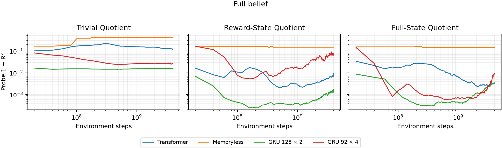
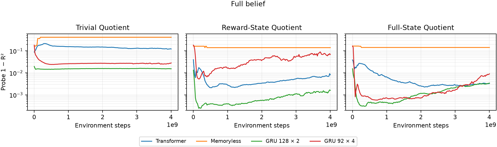
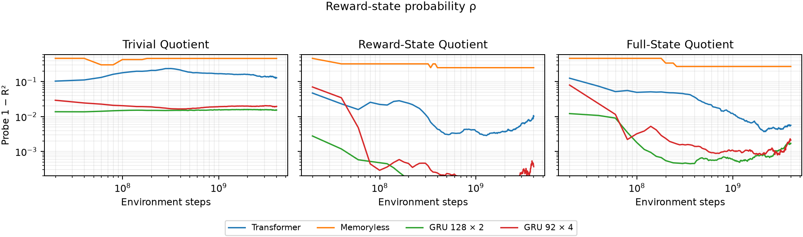
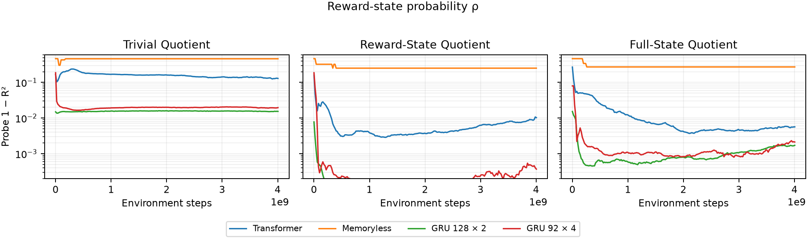
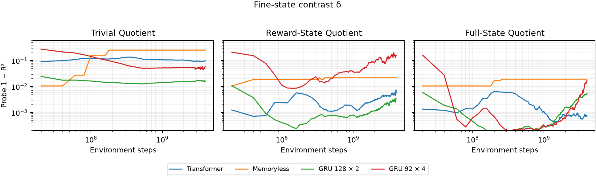
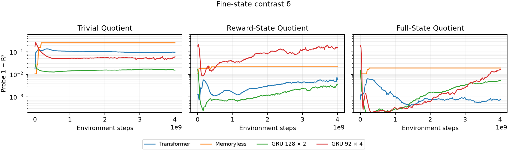

# Additional belief-target probes — temperature-1.5 Belief-Quotient Ladder

Seed 42; all 12 arms × 202 checkpoints (2,424 evaluations), including actual initialization. Greedy held-out embedding probes use the original fixed key, 60,000 fit / 80,000 test rows, 64-step per-episode warmup, and ridge 10⁻⁶. Reward is the held-out post-warmup reward per step, not probe accuracy.

Maximum absolute full-belief R² difference from the archive: **9.84805209503e-06**.

Uniform nonreward destinations and symmetric emissions make A/B tokens carry identical reward-class likelihood: c[B] equals ρ for Trivial Quotient and Reward-State Quotient, up to numerical precision. Both targets are retained and fitted independently. Full-State Quotient is not lumpable, so its coarse target is omitted.

The quotient filter processes complete token/action episodes before warmup removal, conditions on the reset observation without a transition, and then uses the preceding executed action. These descriptive linear-accessibility measurements do not establish causal use. Single seed; no confidence intervals.

## Final checkpoint

All entries below except reward are **1 − R²** (smaller is better); final step = 4,004,511,744.

| Condition / architecture | Full belief | Reward state ρ | Fine contrast δ | Coarse c[B] | Reward/step |
|---|---:|---:|---:|---:|---:|
| Trivial Quotient / Transformer | 0.12288 | 0.129489 | 0.0978911 | 0.129489 | 0.722512 |
| Trivial Quotient / Memoryless | 0.418625 | 0.461884 | 0.255055 | 0.461883 | 0.722512 |
| Trivial Quotient / GRU 128 × 2 | 0.0154177 | 0.0153706 | 0.0155958 | 0.0153706 | 0.722512 |
| Trivial Quotient / GRU 92 × 4 | 0.0283017 | 0.0196092 | 0.0611705 | 0.0196092 | 0.722512 |
| Reward-State Quotient / Transformer | 0.00821824 | 0.0102609 | 0.00573631 | 0.0102609 | 0.315562 |
| Reward-State Quotient / Memoryless | 0.14093 | 0.251809 | 0.0218083 | 0.251809 | 0.288337 |
| Reward-State Quotient / GRU 128 × 2 | 0.00161101 | 0.000141626 | 0.00342757 | 0.000141626 | 0.319737 |
| Reward-State Quotient / GRU 92 × 4 | 0.0686484 | 0.000367838 | 0.153062 | 0.000367838 | 0.319737 |
| Full-State Quotient / Transformer | 0.00331784 | 0.00564467 | 0.000767074 | — | 0.287900 |
| Full-State Quotient / Memoryless | 0.143518 | 0.272695 | 0.0192758 | — | 0.262000 |
| Full-State Quotient / GRU 128 × 2 | 0.00344375 | 0.00171123 | 0.00540523 | — | 0.295413 |
| Full-State Quotient / GRU 92 × 4 | 0.00906073 | 0.00212647 | 0.0168749 | — | 0.294313 |

## Figures

One figure per target and x-axis convention; shared log y-axis 2×10⁻⁴–0.6. Log-x plots omit initialization because log(0) is undefined; linear-x plots include it. Values outside the requested y range are not clipped in the underlying JSON or final table.

![Coarse reward-class probability c[B], log x](figures/reprobe_coarse_reward_class_logx.png)
![Coarse reward-class probability c[B], linear x](figures/reprobe_coarse_reward_class_linearx.png)

## Reproduction and CPU check

Run `uv run python -m experiments.belief_quotient_history_jax_lumped_temp15_2026_11.reprobe --leaf LEAF` for each leaf, then `uv run python -m experiments.belief_quotient_history_jax_lumped_temp15_2026_11.plot_reprobe`. Input SHA-256 hashes are in `figures/reprobe_plot_manifest.json`; per-checkpoint parameter hashes, source run commits, target definitions, budgets, and archive parity differences are in each `reprobe_targets.json`.

Local machine: 8 CPUs. Full-budget initialization checks took 14.17 s (Transformer) and 6.83 s (GRU 92 × 4), including fetch/load/JIT/fits. CPU full-belief archive differences were 2.54×10⁻⁵ and 0.07414 respectively. The same GRU checkpoint on an existing 4090 matched within 1.3×10⁻¹²; production reprobes therefore used existing idle 4090 boxes with their original JAX environments. No boxes were rented or destroyed. The three-checkpoint memoryless CPU validation is retained separately and matched within 1.25×10⁻⁸.
