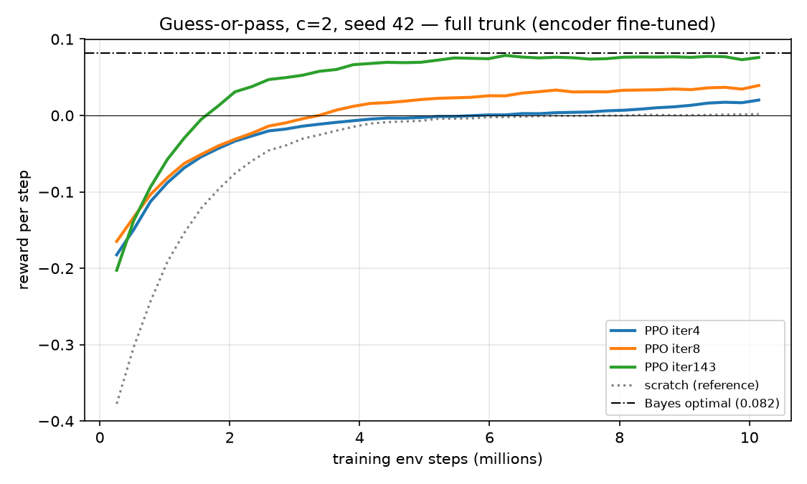
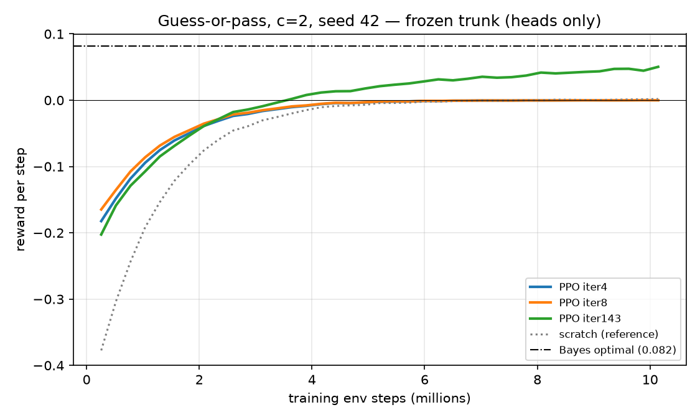
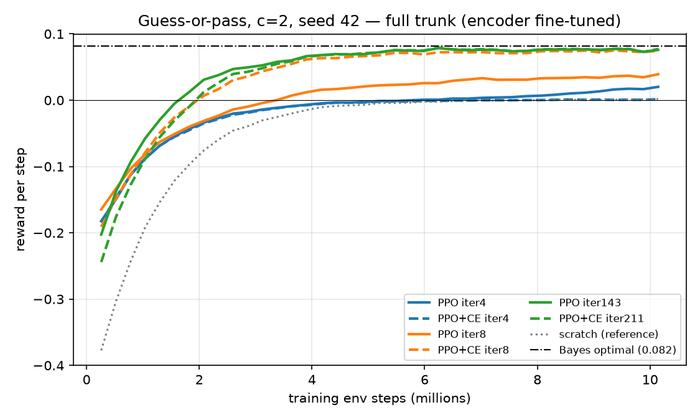
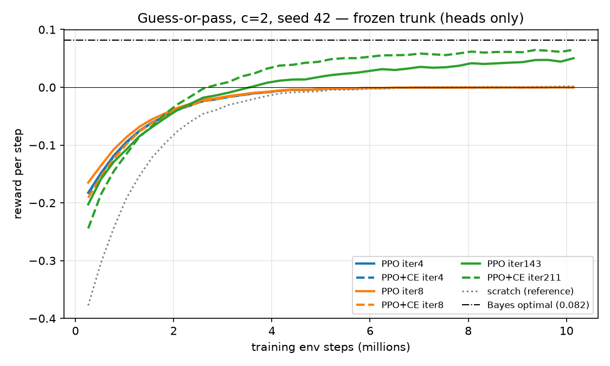

# Pusher-B b10 guess-or-pass in JAX

Pure-JAX PPO transfer campaign port of
`experiments/pusher_b10_checkpoint_transfer_2026_10/guess_or_pass_rllib`; the RLlib study remains the
fallback. Actions 0/1 guess the pending token and action 2 passes. Rewards are
`+1`, `-cost`, and `0`.

The converter maps the RLlib encoder's token and BOS embeddings, RMSNorm
scales, QKV/output projections, and gated-GELU MLP weights into the matching
JAX trunk. Every encoder key and tensor shape is checked; non-encoder
parameters are listed as ignored. Each transfer also compares encoder
activations on 16 fixed-seed sequences and requires maximum absolute error
below `1e-4`.

List and launch the campaign:

```bash
uv run python -m experiments.pusher_b10_checkpoint_transfer_2026_10.guess_or_pass_jax.campaign --list
uv run python -m experiments.pusher_b10_checkpoint_transfer_2026_10.guess_or_pass_jax.campaign \
  --run-index 0 21 --frozen-cost 1.5 --smoke --hardware cpu --no-upload-artifacts
```

GPU setup and a scratch run:

```bash
uv sync --group jax-cuda
uv run rl-harness experiments.pusher_b10_checkpoint_transfer_2026_10.guess_or_pass_jax.ppo_c2.experiment
```

Four CPU smoke runs (2,032 steps each) measured 2,663–3,919 active env
steps/s. The full-trunk PPO transfer parity error was `3.10e-6`; the frozen
PPO+NTP transfer error was `6.68e-6`, and both frozen-trunk/head-update checks
passed. On a Vast RTX 4090 the scratch `c=2` run (10M env steps) measured
187k active env steps/s (~54 s of training plus ~8 s compile). The parity
check runs the JAX encoder at `jax.default_matmul_precision("highest")`;
with the GPU default (TF32) the Torch/JAX difference is ~1.4e-3 and would
trip the `1e-4` tolerance.

## Results (seed 42, 10M env steps, Vast RTX 4090)

All 27 runs completed at 165–190k active env steps/s (~1 min each). Compact
results live under `ppo_c*/results/<run>/`; parameters and metrics are on B2
(`run_manifest.json` → `remote_artifacts`). The frozen phase was launched with
`--frozen-cost 2` after the full runs: `c=1` and `c=1.5` are control rungs where
every source and scratch reach the Bayes reward, so only `c=2` separates
trunks.

Reward per step at 10M steps (Bayes: c=2 0.082, c=1.5 0.149, c=1 0.275):

| source | c=2 full | c=2 frozen | c=1.5 full | c=1 full |
|---|---|---|---|---|
| scratch | 0.002 | — | 0.145 | 0.276 |
| ppo_iter4 | 0.020 | 0.000 | 0.145 | 0.276 |
| ppo_iter8 | 0.039 | 0.000 | 0.146 | 0.276 |
| ppo_iter143 | 0.076 | 0.050 | 0.147 | 0.276 |
| ppo_ce_iter4 | 0.002 | 0.000 | 0.138 | 0.276 |
| ppo_ce_iter8 | 0.075 | 0.000 | 0.143 | 0.276 |
| ppo_ce_iter211 | 0.077 | 0.065 | 0.146 | 0.276 |

At c=2, scratch and both iter-4 trunks collapse to always-pass (pass rate
≈ 0.99). With a trainable trunk, PPO iter 143, PPO+CE iter 8 and PPO+CE
iter 211 reach ~93% of Bayes. With the trunk frozen only the late checkpoints
support a useful head (PPO+CE iter 211 0.065 > PPO iter 143 0.050); PPO+CE
iter 8 falls back to 0, so its full-trunk advantage over PPO iter 8 is in
fine-tunability rather than a linearly readable representation. All frozen
runs report `frozen_encoder_update_verified: true`.

Reward curves at c=2 (`python -m experiments.pusher_b10_checkpoint_transfer_2026_10.guess_or_pass_jax.plots`):

| | full trunk | frozen trunk |
|---|---|---|
| PPO checkpoints |  |  |
| PPO vs PPO+CE |  |  |
