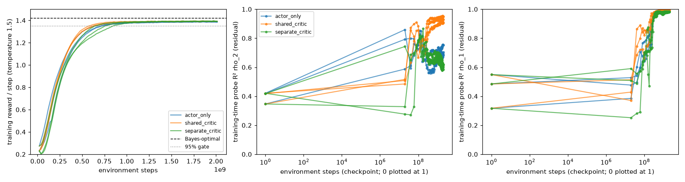

# Reward-State × Trivial: does a critic make the actor trunk represent a control-irrelevant, value-relevant factor?

Study code: `process.py`, `design.py`, `algorithms.py`, `shared.py`, `arm_queue.py`, `posthoc.py`, `analyze.py`.
Compact outputs: `results/design.json`, `results/posthoc.json`, `results/summary.{json,md}`, `results/curves.png`,
and per-run `<arm>_transformer/results/<arm>-seed<seed>/`. Checkpoints are on B2 only.

## Design (verified before training: `results/design.json`)

Two independently evolving 3-state factors with Kronecker-product transitions and observations (18 tokens, 9 joint
actions). Factor 1 uses the Reward-State action dynamics and factor 2 the Trivial ones. Reward is additive:
`1[s1 = 2] + 1[s2 = 2]`. gamma = 0.99.

- **Control is 1-D.** Full-simplex value iteration (301 × 101 grid per factor, residual < 1e-9) gives factor-2 argmax
  action 1 on 100% of beliefs, with a minimum Q gap of 0.26. The factor-1 action depends only on
  `rho_1 = P(s1 = 2)`, with a switch at rho_1 = 0.18 for every value of the within-{0,1} imbalance coordinate.
  A policy that thresholds rho_1 and plays a2 = 1 reaches 1.409 ± 0.009 reward/step. The full Bayes policy reaches
  1.409 ± 0.009 on the same seeds and 1.419 ± 0.007 on 512 episodes.
- **Value is 2-D.** The 9-state Bellman residual of V1 + V2 is 0.0015, so value is additive. On visited beliefs the
  scaled V* has affine R² of 0.898 from rho_1 alone and 0.997 from (rho_1, rho_2); factor 2 carries 10.4% of the
  value variance. Factor-2 value is exactly affine in rho_2 (R² = 1.0). The local alpha-vector covariance has a
  dominant direction aligned with rho_1 (cosine 1.000), and the residual off that direction aligns with rho_2
  (cosine 1.000).
- **Filtering is not 1-D.** Tokens 0 and 1 have different likelihoods under latent states 0 and 1, so the exact
  filter also needs the imbalance coordinate `delta = P(s=0) - P(s=1)`. A rho-only merged-token filter is kept only
  as a deliberately imperfect control. delta_2 is a filtering coordinate that value does not need, so it separates
  "the trunk encodes the value-relevant factor" from "the trunk runs the full discounted filter."
- **Performance references (reward/step):** Bayes 1.419. Best constant action (a1 = 1, a2 = 1) 1.138.
  Uniform random 0.280. Bayes actions applied to a context-32 restarted filter 1.396 ± 0.036.

## Arms and budget (identical across arms and seeds)

| | actor_only | shared_critic | separate_critic |
|---|---|---|---|
| advantage | standardized Monte Carlo discounted reward-to-go | standardized GAE(0.95) | standardized GAE(0.95) |
| value pathway | none | linear head on the policy trunk's final embedding | independent 64×4 transformer trunk with its own linear head |
| value gradients into actor trunk | n/a | yes | no |

All arms share a 4-layer, width-64, 1-head transformer with banded attention (32-key band per layer, 129-step
stacked receptive field). Training settings: 2,012,217,344 env steps (101 iterations × 19,456 envs × 1,024 steps),
continuing episodes, PPO clip 0.2, 4 epochs, 64 minibatches, Adam 4.2e-4, temperature 1.5 in both rollout and
likelihood, entropy coefficient 0, epsilon exploration 0, no KL penalty, no value clipping, and value targets
scaled by (1 − gamma). Seeds 42, 43 and 44 share the same initial policy trunk across arms (identical step-0
probes). Probes and steering use the pre-final-LayerNorm residual of the last layer.

**Budget disclosure.** Env-step budgets are identical. The separate critic has twice the trunk parameters and took
about 1.6× the wall-clock time of the other arms. Seed 43 ran on an RTX 5090; seeds 42 and 44 ran on RTX 4090s.
The recipe and code are the same on both GPU types. Actor-only differs from the critic arms in its advantage
estimator (MC versus GAE) as well as in having no critic. This is the practical baseline, but it is a confound
(see Limits).

## Results (mean ± s.e. over 3 seeds; per-seed values in `results/summary.md` and `results/posthoc.json`)

**Performance and convergence.** All 9 runs pass the reward gate (95% of Bayes, 1.348). Training reward/step at
temperature 1.5 has plateaued in every run: the last-10-iteration slope is at most 0.0011 per 1e8 steps.

| arm | train reward (last 10 it.) | steps to 95% gate | post-hoc greedy | post-hoc sampled |
|---|---|---|---|---|
| actor_only | 1.386 ± 0.000 | 0.64–0.72B | 1.428 ± 0.008 | 1.423 ± 0.010 |
| shared_critic | 1.392 ± 0.001 | 0.58–0.64B | 1.436 ± 0.011 | 1.425 ± 0.012 |
| separate_critic | 1.392 ± 0.001 | 0.66–0.86B | 1.431 ± 0.009 | 1.427 ± 0.012 |

The post-hoc figures come from 64 episodes, exclude the first 64 steps, and have about ±0.01 Monte Carlo error.
Values above the 1.419 Bayes reference are within that noise.

**Control uses only rho_1 in every arm.**

- All arms play a2 = 1 on 100% of post-hoc decisions.
- Affine fit of tempered log-policy from rho_2: actor_only 0.025 ± 0.017, shared ≈ 0.000, separate ≈ 0.000.
  From rho_1: 0.64–0.77.
- Steering the residual by one visited standard deviation along the partial-regression encoding direction
  (mean policy TV):

| arm | rho_1 | rho_2 | rho_2 at rho_1's norm | random direction at rho_1's norm |
|---|---|---|---|---|
| actor_only | 0.237 ± 0.017 | 0.001 | 0.012 ± 0.000 | 0.016 ± 0.002 |
| shared_critic | 0.139 ± 0.026 | 0.001 | 0.008 ± 0.005 | 0.007 ± 0.003 |
| separate_critic | 0.144 ± 0.019 | 0.001 | 0.027 ± 0.012 | 0.007 ± 0.000 |

**Representation: a shared critic adds rho_2 to the actor trunk.** Held-out affine probe R² on the residual
(61,440 rows per split):

| target | untrained | actor_only | shared_critic | separate_critic (actor trunk) |
|---|---|---|---|---|
| rho_1 | 0.364 ± 0.006 | 0.985 ± 0.001 | 0.992 ± 0.001 | 0.981 ± 0.001 |
| **rho_2** | 0.416 ± 0.019 | 0.696 ± 0.026 | **0.927 ± 0.005** | 0.609 ± 0.014 |
| delta_2 (filter-only) | – | 0.116 ± 0.039 | 0.161 ± 0.065 | 0.171 ± 0.051 |
| value_star | 0.395 ± 0.025 | 0.958 ± 0.003 | 0.988 ± 0.001 | 0.942 ± 0.003 |

- **Paired per seed, shared − actor_only, rho_2:** +0.242, +0.192, +0.262 for seeds 42, 43 and 44, giving
  +0.232 ± 0.021. The training-time probe battery agrees: +0.25, +0.18, +0.22.
- **Separate − actor_only, rho_2:** −0.057, −0.129, −0.074, giving −0.086 ± 0.022. The training-time probes give
  −0.09, −0.13, −0.10.
- **Ramp (`curves.png`, middle panel):** rho_2 R² rises together with reward in all arms, then splits after roughly
  1e8–3e8 steps. In the shared arm it keeps climbing to about 0.93. In the actor-only and separate arms it falls back
  toward about 0.6–0.75 as the policy sharpens.

**Critics encode both factors.** Affine R² of the value head against value_star:

- shared critic: 0.988 ± 0.001;
- separate critic: 0.978 ± 0.001.

For both heads, (rho_1, rho_2) explains the value head better than rho_1 alone: shared 0.988 versus 0.923,
separate 0.978 versus 0.909. Both heads underweight factor 2: their rho_2/rho_1 coefficient ratio is 0.71 ± 0.01
(shared) and 0.77 ± 0.02 (separate), against 0.92 for V*.

**Independent factors versus discounted filtering.**

- **History is available.** Uniform-prior exact filters restarted 129 steps back (the receptive field) recover
  every coordinate with R² = 1.000. A trunk with the full filter is therefore possible.
- **Single-band reference.** With 33 decisions (one attention band), the exact filter gives rho_2 R² of 0.71 ± 0.01
  and delta_2 R² of 0.70–0.71. A linear readout of the last 33 one-hot observations gives rho_2 R² of 0.62–0.63.
- **Arm comparison.** The shared trunk's rho_2 (0.93) exceeds the single-band references, so value pressure drives
  integration across layers and further back in history. The actor-only trunk is roughly at the single-band filter
  level, and the separate-critic actor trunk is near the linear observation window.
- **delta_2.** This coordinate is needed for exact filtering but not for value. It stays weak in every arm
  (0.12–0.17, high seed variance), below even the 33-step filter reference.
- **Reading.** The critic adds the value-relevant factor coordinate (rho_2), not the full discounted filter state
  for factor 2. The isolation is not complete: the factor-1 filter coordinate delta_1 is encoded at 0.69–0.79 in
  all arms, because rho_1 is control-relevant.

## Interpretation

The geometric prediction holds in this regime. When control needs one direction and value needs two, a policy
trunk shared with a value head carries the second, control-irrelevant value direction. Its rho_2 probe R² is 0.93,
against 0.70 without a critic, and the sign of the difference is the same on all 3 seeds. Behaviour is unchanged:
rho_2 has no policy effect beyond a random-direction control. Isolating the critic in its own trunk does not just
remove the effect; it lowers rho_2 below actor-only (−0.09 on every seed).

A plausible but untested explanation is that baseline-free Monte Carlo returns inject factor-2 reward variance into
actor-only policy gradients. A GAE critic absorbs that variance instead.

## Limits

- 3 seeds; s.e. is across seeds. Probes measure linear accessibility, not use.
- Steering is local, applied at one residual site, and measured by policy TV only.
- actor_only differs from the critic arms in both critic presence and advantage estimator (MC vs GAE(0.95)).
  shared − separate is the clean "value gradient into the trunk" contrast: +0.30, +0.32 and +0.34 rho_2 R² for seeds 42, 43 and 44.
- Probes run under each arm's own on-policy state distribution. All arms play a2 = 1, so the factor-2 state
  distributions are matched.
- The Bayes reference is a grid value-iteration policy; it is not certified exact.
- Mixed GPU types across seeds (RTX 5090 for seed 43).

## Provenance and infrastructure

- **Launch ref:** `622c35fc` on `devin/1795597394-rs-trivial-critic`. Harness `a267508f`.
- **Remote command:** `python -m experiments.reward_factors_rs_trivial_eps02_jax_temp15_ctx32_2026_11.arm_queue --seed <seed>`.
  Arms ran sequentially per box in the order separate → shared → actor_only.
- **Vast (on-demand, 6 h max age):**
  - seed 42 → 62496523 (RTX 4090);
  - seed 43 → 62496843 (RTX 5090);
  - seed 44 → 62499436 (RTX 4090).
- **Failed box:** 62497438 stayed `loading` for 15 min and was destroyed by provisioning, then replaced.
- **Teardown:** all instances were destroyed after the B2 durability manifests were verified. Each run has 107 of
  107 manifest files present with matching sizes.
- **Post-hoc analysis:** `posthoc.py` ran locally on CPU from the B2 final and step-0 checkpoints, with 64 episodes
  per fit and test split.
