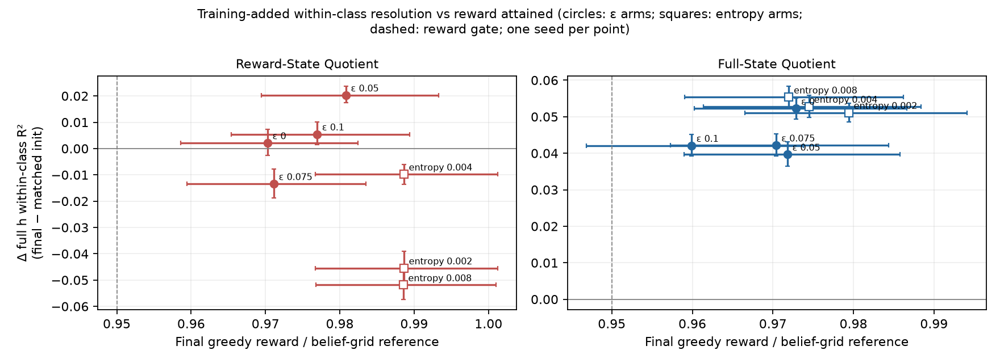
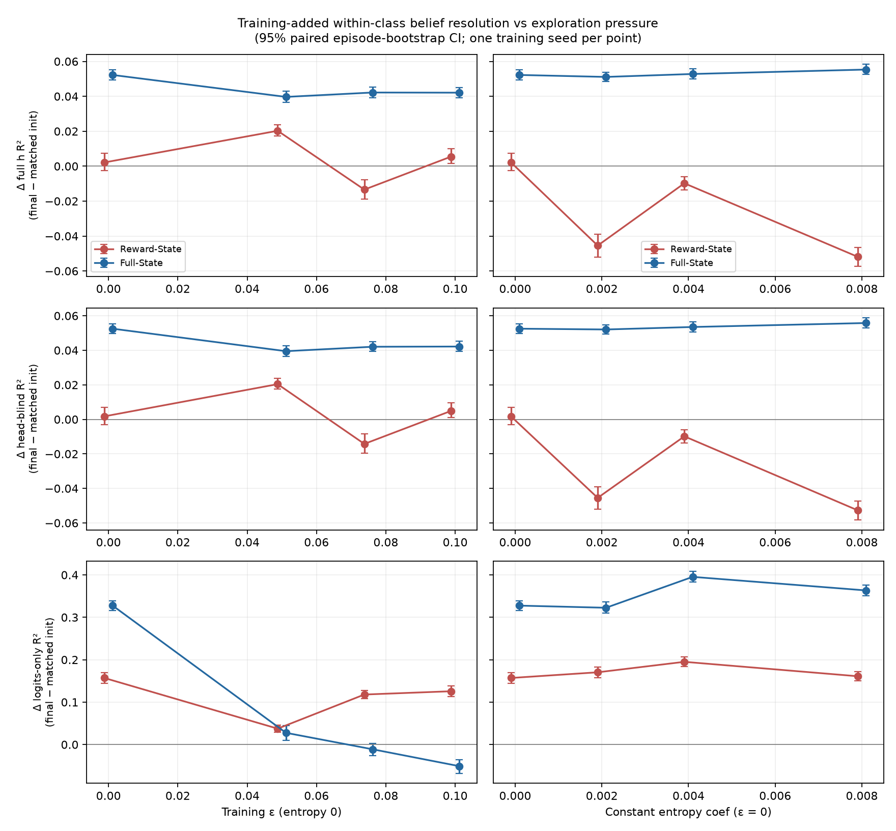
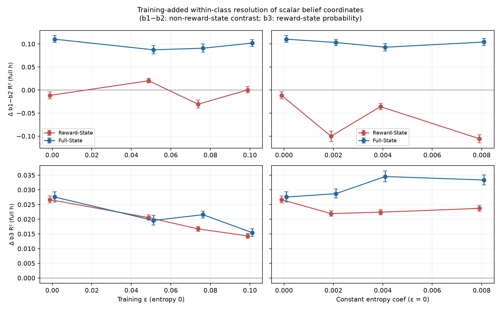
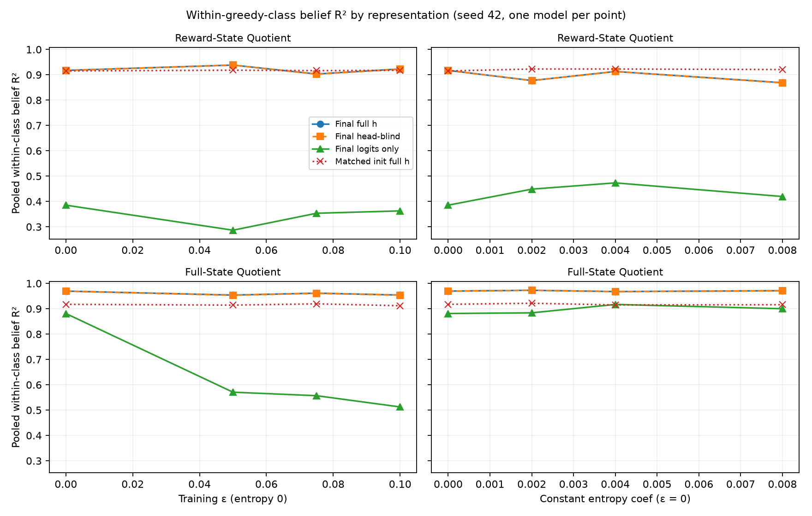
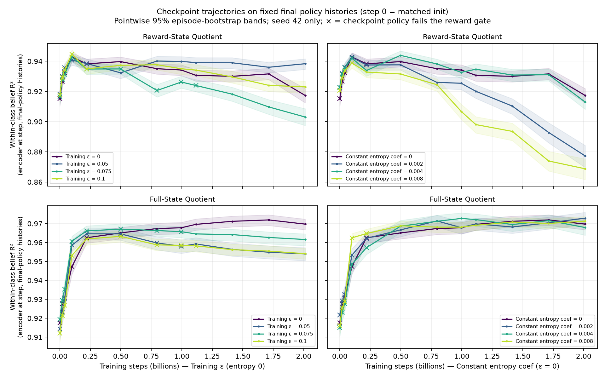

# Results: exploration pressure vs within-class belief resolution

Generated by `report.py` from `within_class_exploration_sweep.json`. Δ is final minus matched-init (init encoder replayed on the final policy's exact histories); 95% intervals are 10,000 paired whole-episode resamples conditional on one training seed (42).

#### Reward attained (gate for the belief-resolution comparison)

Reference: belief-MDP value iteration on a simplex grid (`reward_reference.py`), its lookahead policy simulated with the exact filter for 4,096 episodes under the probe protocol (1,024 steps, 64-step warmup excluded). It is near-optimal (grid/discount sweep converged), not a certified Bayes bound. Reward-State: reference 0.5334, myopic-belief 0.5334, best current-token 0.3476, Noop 0.1761. Full-State: reference 0.4903, myopic-belief 0.4878, best current-token 0.3081, Noop 0.1761.
Policies are greedy, 4,096 fresh episodes each; gate: final greedy reward >= 95% of the belief-grid reference. Arm − best arm uses common random numbers (shared rollout key) and a paired episode bootstrap. First gated step / gated peak use the sampled checkpoints: checkpoints screened with 84-episode probe-stream rewards; those >= 80% of reference re-evaluated with 1024 fresh episodes (same key).

| Quotient | Setting | Final reward/step [95% CI] | / reference [95% CI] | Gate | Arm − best arm [95% CI] | First gated checkpoint | Gated peak (fixed hist.) | Gated peak − final |
|---|---|---|---|---|---|---:|---|---:|
| Reward-State | ε 0 | 0.5176 [0.5130, 0.5218] | 0.970 [0.959, 0.982] | pass | -0.0098 [-0.0126, -0.0070] | 498M | 0.9398 @ 498M | +0.0224 |
| Reward-State | ε 0.05 | 0.5232 [0.5188, 0.5275] | 0.981 [0.969, 0.993] | pass | -0.0042 [-0.0064, -0.0019] | 498M | 0.9401 @ 797M | +0.0018 |
| Reward-State | ε 0.075 | 0.5180 [0.5136, 0.5223] | 0.971 [0.959, 0.983] | pass | -0.0093 [-0.0121, -0.0065] | 1,415M | 0.9182 @ 1,415M | +0.0151 |
| Reward-State | ε 0.1 | 0.5211 [0.5166, 0.5253] | 0.977 [0.965, 0.989] | pass | -0.0062 [-0.0087, -0.0037] | 498M | 0.9377 @ 797M | +0.0147 |
| Reward-State | entropy 0.002 | 0.5274 [0.5228, 0.5317] | 0.989 [0.977, 1.001] | pass | +0.0000 [+0.0000, +0.0000] | 498M | 0.9376 @ 498M | +0.0603 |
| Reward-State | entropy 0.004 | 0.5274 [0.5228, 0.5317] | 0.989 [0.977, 1.001] | pass | +0.0000 [+0.0000, +0.0000] | 219M | 0.9439 @ 498M | +0.0309 |
| Reward-State | entropy 0.008 | 0.5273 [0.5230, 0.5317] | 0.989 [0.977, 1.001] | pass | -0.0000 [-0.0018, +0.0018] | 219M | 0.9328 @ 219M | +0.0641 |
| Full-State | ε 0 | 0.4770 [0.4724, 0.4816] | 0.973 [0.960, 0.987] | pass | -0.0032 [-0.0055, -0.0010] | 498M | 0.9719 @ 1,713M | +0.0022 |
| Full-State | ε 0.05 | 0.4765 [0.4717, 0.4810] | 0.972 [0.959, 0.986] | pass | -0.0037 [-0.0061, -0.0013] | 1,116M | 0.9592 @ 1,116M | +0.0052 |
| Full-State | ε 0.075 | 0.4758 [0.4710, 0.4803] | 0.970 [0.957, 0.984] | pass | -0.0044 [-0.0070, -0.0019] | 1,116M | 0.9645 @ 1,116M | +0.0029 |
| Full-State | ε 0.1 | 0.4706 [0.4658, 0.4751] | 0.960 [0.947, 0.974] | pass | -0.0096 [-0.0124, -0.0067] | 1,415M | 0.9562 @ 1,415M | +0.0021 |
| Full-State | entropy 0.002 | 0.4802 [0.4755, 0.4849] | 0.979 [0.966, 0.994] | pass | +0.0000 [+0.0000, +0.0000] | 498M | 0.9729 @ 2,012M | +0.0000 |
| Full-State | entropy 0.004 | 0.4778 [0.4731, 0.4824] | 0.974 [0.961, 0.988] | pass | -0.0024 [-0.0046, -0.0004] | 498M | 0.9727 @ 996M | +0.0048 |
| Full-State | entropy 0.008 | 0.4765 [0.4719, 0.4810] | 0.972 [0.959, 0.986] | pass | -0.0036 [-0.0060, -0.0013] | 498M | 0.9713 @ 2,012M | +0.0000 |

#### Within-class probes

| Quotient | Setting | Final reward/step | Final actions [Noop, X, Y] | Final h | Matched init | Δ full h [95% CI] | Δ head-blind [95% CI] | Δ logits [95% CI] | Final head-blind − logits |
|---|---|---:|---|---:|---:|---|---|---|---:|
| Reward-State | ε 0 | 0.5011 | [0.59, 0.41, 0.00] | 0.9173 | 0.9152 | +0.0021 [-0.0025, +0.0073] | +0.0017 [-0.0029, +0.0068] | +0.1570 [+0.1447, +0.1700] | +0.5313 |
| Reward-State | ε 0.05 | 0.5055 | [0.62, 0.38, 0.00] | 0.9384 | 0.9181 | +0.0203 [+0.0174, +0.0236] | +0.0204 [+0.0175, +0.0237] | +0.0375 [+0.0295, +0.0457] | +0.6517 |
| Reward-State | ε 0.075 | 0.4985 | [0.59, 0.41, 0.00] | 0.9030 | 0.9164 | -0.0134 [-0.0188, -0.0077] | -0.0142 [-0.0197, -0.0085] | +0.1179 [+0.1080, +0.1281] | +0.5486 |
| Reward-State | ε 0.1 | 0.5041 | [0.61, 0.39, 0.00] | 0.9230 | 0.9175 | +0.0055 [+0.0015, +0.0102] | +0.0049 [+0.0009, +0.0095] | +0.1257 [+0.1132, +0.1385] | +0.5594 |
| Reward-State | entropy 0.002 | 0.5151 | [0.66, 0.34, 0.00] | 0.8773 | 0.9228 | -0.0455 [-0.0521, -0.0390] | -0.0455 [-0.0520, -0.0391] | +0.1703 [+0.1581, +0.1832] | +0.4285 |
| Reward-State | entropy 0.004 | 0.5151 | [0.66, 0.34, 0.00] | 0.9130 | 0.9228 | -0.0098 [-0.0135, -0.0060] | -0.0098 [-0.0136, -0.0060] | +0.1951 [+0.1835, +0.2072] | +0.4395 |
| Reward-State | entropy 0.008 | 0.5062 | [0.64, 0.36, 0.00] | 0.8688 | 0.9206 | -0.0519 [-0.0573, -0.0464] | -0.0527 [-0.0581, -0.0472] | +0.1611 [+0.1508, +0.1719] | +0.4483 |
| Full-State | ε 0 | 0.4652 | [0.61, 0.18, 0.21] | 0.9697 | 0.9175 | +0.0522 [+0.0494, +0.0551] | +0.0525 [+0.0497, +0.0554] | +0.3276 [+0.3163, +0.3393] | +0.0882 |
| Full-State | ε 0.05 | 0.4710 | [0.61, 0.20, 0.19] | 0.9540 | 0.9143 | +0.0397 [+0.0364, +0.0431] | +0.0395 [+0.0363, +0.0428] | +0.0277 [+0.0102, +0.0443] | +0.3826 |
| Full-State | ε 0.075 | 0.4650 | [0.59, 0.20, 0.21] | 0.9616 | 0.9194 | +0.0422 [+0.0393, +0.0453] | +0.0421 [+0.0393, +0.0451] | -0.0112 [-0.0262, +0.0029] | +0.4041 |
| Full-State | ε 0.1 | 0.4570 | [0.58, 0.20, 0.22] | 0.9541 | 0.9120 | +0.0421 [+0.0392, +0.0451] | +0.0422 [+0.0393, +0.0452] | -0.0510 [-0.0677, -0.0355] | +0.4412 |
| Full-State | entropy 0.002 | 0.4658 | [0.63, 0.19, 0.18] | 0.9729 | 0.9218 | +0.0511 [+0.0486, +0.0537] | +0.0521 [+0.0495, +0.0547] | +0.3225 [+0.3099, +0.3360] | +0.0887 |
| Full-State | entropy 0.004 | 0.4652 | [0.62, 0.17, 0.21] | 0.9679 | 0.9151 | +0.0528 [+0.0499, +0.0558] | +0.0535 [+0.0506, +0.0565] | +0.3954 [+0.3834, +0.4083] | +0.0507 |
| Full-State | entropy 0.008 | 0.4633 | [0.60, 0.19, 0.21] | 0.9713 | 0.9160 | +0.0553 [+0.0525, +0.0583] | +0.0558 [+0.0529, +0.0588] | +0.3634 [+0.3510, +0.3762] | +0.0707 |

#### Scalar targets (full h)

| Quotient | Setting | Final b1−b2 | Matched b1−b2 | Δ b1−b2 [95% CI] | Final b3 | Matched b3 | Δ b3 [95% CI] |
|---|---|---:|---:|---|---:|---:|---|
| Reward-State | ε 0 | 0.8728 | 0.8845 | -0.0116 [-0.0190, -0.0036] | 0.9966 | 0.9699 | +0.0267 [+0.0255, +0.0279] |
| Reward-State | ε 0.05 | 0.9021 | 0.8820 | +0.0201 [+0.0154, +0.0255] | 0.9943 | 0.9737 | +0.0205 [+0.0196, +0.0215] |
| Reward-State | ε 0.075 | 0.8531 | 0.8838 | -0.0307 [-0.0391, -0.0219] | 0.9899 | 0.9732 | +0.0167 [+0.0159, +0.0176] |
| Reward-State | ε 0.1 | 0.8847 | 0.8845 | +0.0002 [-0.0062, +0.0077] | 0.9871 | 0.9728 | +0.0143 [+0.0136, +0.0152] |
| Reward-State | entropy 0.002 | 0.7779 | 0.8783 | -0.1003 [-0.1117, -0.0893] | 0.9993 | 0.9774 | +0.0219 [+0.0210, +0.0229] |
| Reward-State | entropy 0.004 | 0.8423 | 0.8783 | -0.0360 [-0.0427, -0.0293] | 0.9998 | 0.9774 | +0.0224 [+0.0215, +0.0234] |
| Reward-State | entropy 0.008 | 0.7757 | 0.8812 | -0.1056 [-0.1143, -0.0969] | 0.9998 | 0.9761 | +0.0237 [+0.0227, +0.0247] |
| Full-State | ε 0 | 0.9239 | 0.8135 | +0.1104 [+0.1031, +0.1178] | 0.9892 | 0.9616 | +0.0276 [+0.0259, +0.0293] |
| Full-State | ε 0.05 | 0.8975 | 0.8101 | +0.0873 [+0.0786, +0.0963] | 0.9778 | 0.9583 | +0.0196 [+0.0180, +0.0213] |
| Full-State | ε 0.075 | 0.9060 | 0.8152 | +0.0908 [+0.0822, +0.1000] | 0.9852 | 0.9637 | +0.0215 [+0.0205, +0.0227] |
| Full-State | ε 0.1 | 0.9055 | 0.8035 | +0.1020 [+0.0946, +0.1097] | 0.9758 | 0.9603 | +0.0154 [+0.0141, +0.0168] |
| Full-State | entropy 0.002 | 0.9216 | 0.8184 | +0.1032 [+0.0966, +0.1101] | 0.9950 | 0.9663 | +0.0287 [+0.0272, +0.0303] |
| Full-State | entropy 0.004 | 0.9090 | 0.8160 | +0.0929 [+0.0848, +0.1008] | 0.9948 | 0.9602 | +0.0345 [+0.0327, +0.0364] |
| Full-State | entropy 0.008 | 0.9187 | 0.8144 | +0.1042 [+0.0967, +0.1118] | 0.9950 | 0.9616 | +0.0333 [+0.0317, +0.0351] |

#### Controls (final encoder, full belief) and checks

| Quotient | Setting | Shuffle | Random input | Label perm. | One-class final | Max archive |Δ| | Archive annotations |
|---|---|---:|---:|---:|---|---:|---|
| Reward-State | ε 0 | +0.0072 | -0.0083 | +0.0013 | No | 4.3e-05 | — |
| Reward-State | ε 0.05 | +0.0081 | -0.0086 | -0.0005 | No | 9.6e-05 | — |
| Reward-State | ε 0.075 | +0.0007 | -0.0170 | -0.0075 | No | 9.6e-05 | — |
| Reward-State | ε 0.1 | +0.0021 | -0.0149 | -0.0087 | No | 9.6e-05 | — |
| Reward-State | entropy 0.002 | +0.0080 | -0.0057 | -0.0102 | No | 1.4e-04 | — |
| Reward-State | entropy 0.004 | +0.0051 | -0.0094 | -0.0065 | No | 2.2e-04 | — |
| Reward-State | entropy 0.008 | +0.0017 | -0.0072 | -0.0117 | No | 7.3e-04 | — |
| Full-State | ε 0 | +0.0128 | -0.0124 | -0.0115 | No | 2.6e-04 | — |
| Full-State | ε 0.05 | +0.0045 | -0.0102 | +0.0091 | No | 2.6e-04 | — |
| Full-State | ε 0.075 | +0.0089 | -0.0149 | -0.0087 | No | 2.4e-04 | — |
| Full-State | ε 0.1 | +0.0092 | -0.0124 | +0.0101 | No | 2.4e-04 | — |
| Full-State | entropy 0.002 | +0.0149 | -0.0101 | -0.0014 | No | 1.6e-04 | — |
| Full-State | entropy 0.004 | +0.0178 | -0.0149 | +0.0050 | No | 2.4e-04 | — |
| Full-State | entropy 0.008 | +0.0103 | -0.0101 | +0.0087 | No | 2.4e-04 | — |

#### Checkpoint trajectories (fixed final-policy histories)

Each run's 12 prespecified checkpoints (parent PR219 trajectory protocol) are replayed on that run's final-policy histories, classes and targets with the probe refit per encoder. Peaks are chosen after looking, so the paired peak − final interval is exploratory and not selection-adjusted. Peaks here ignore reward; see the reward-gate table for peaks restricted to checkpoints whose policy passes the gate.

| Quotient | Setting | Init (fixed hist.) | Peak | Peak step | Final | Peak − final [95% CI] |
|---|---|---:|---:|---:|---:|---|
| Reward-State | ε 0 | 0.9152 | 0.9428 | 100M | 0.9173 | +0.0255 [+0.0215, +0.0297] |
| Reward-State | ε 0.05 | 0.9181 | 0.9407 | 100M | 0.9384 | +0.0024 [+0.0002, +0.0045] |
| Reward-State | ε 0.075 | 0.9164 | 0.9428 | 100M | 0.9030 | +0.0397 [+0.0349, +0.0446] |
| Reward-State | ε 0.1 | 0.9175 | 0.9447 | 100M | 0.9230 | +0.0217 [+0.0183, +0.0251] |
| Reward-State | entropy 0.002 | 0.9228 | 0.9426 | 100M | 0.8773 | +0.0653 [+0.0596, +0.0712] |
| Reward-State | entropy 0.004 | 0.9228 | 0.9439 | 498M | 0.9130 | +0.0309 [+0.0283, +0.0336] |
| Reward-State | entropy 0.008 | 0.9206 | 0.9389 | 100M | 0.8688 | +0.0701 [+0.0655, +0.0749] |
| Full-State | ε 0 | 0.9175 | 0.9719 | 1,713M | 0.9697 | +0.0022 [+0.0018, +0.0027] |
| Full-State | ε 0.05 | 0.9143 | 0.9646 | 219M | 0.9540 | +0.0106 [+0.0089, +0.0122] |
| Full-State | ε 0.075 | 0.9194 | 0.9671 | 498M | 0.9616 | +0.0055 [+0.0045, +0.0065] |
| Full-State | ε 0.1 | 0.9120 | 0.9633 | 498M | 0.9541 | +0.0091 [+0.0078, +0.0106] |
| Full-State | entropy 0.002 | 0.9218 | 0.9729 | 2,012M | 0.9729 | +0.0000 [+0.0000, +0.0000] |
| Full-State | entropy 0.004 | 0.9151 | 0.9727 | 996M | 0.9679 | +0.0048 [+0.0037, +0.0060] |
| Full-State | entropy 0.008 | 0.9160 | 0.9713 | 2,012M | 0.9713 | +0.0000 [+0.0000, +0.0000] |

